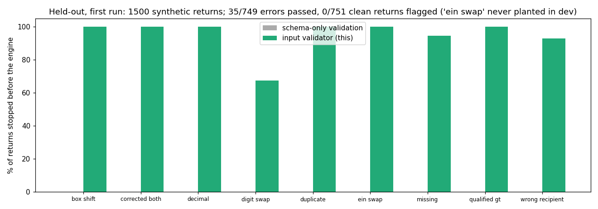

# Validate AI-extracted 1040 inputs before the deterministic engine

> Unofficial prototype by Kushagra Pratap Singh. Not affiliated with Luca IQ. Not tax advice.
> All people, SSNs (never-issued 000 area) and EINs (never-assigned 00 prefix) are synthetic.

## The problem
Luca IQ's principle is that AI sets inputs but never performs the tax math, and "Every field traces back to a source document. Nothing is a guess." ([lucaiq.com](https://lucaiq.com/)). The engine is exact, so **errors come in through inputs**:
- a box read into the next box, or a dropped decimal;
- a spouse's W-2 filed under the other spouse's SSN;
- the same 1099 uploaded twice, or an original kept next to its CORRECTED form;
- last year's brokerage account with no document this year.

Deterministic math on a wrong input gives a confidently wrong return. In the demo, a misfiled W-2 moves an $8,332.80 excess Social Security credit from Priya to a $3,893.60 credit for Arjun.

## What I built
`taxin/` (stdlib):
- **`forms.py`** makes synthetic households (taxpayer ± spouse) with 2025 documents:
  - W-2s from 1–3 employers, including 401(k) code D and two well-paid jobs over the wage base;
  - 1099-INT, 1099-DIV, 1098;
  - last year's payer list.
- **`extract.py`** produces what an AI extraction hands the engine: the true documents, plus (for half the returns) one realistic slip. The slips are swapped digits, box shift, decimal, wrong spouse, duplicate upload, original + CORRECTED both kept, a missing account, and qualified > ordinary dividends.
- **`validate.py`** runs deterministic checks, each citing the document and box:
  - **W-2:** box 4 = 6.2% × min(box 3, $176,100) (2025 wage base, max $10,918.20); box 6 = 1.45% × box 5 + 0.9% over $200,000; box 3 ≤ wage base; box 1 ≈ box 5 − pre-tax deferrals (12D/E/F/G/S); box 2 ≤ box 1.
  - **1099-DIV:** 1b ≤ 1a, 2b ≤ 2a. **1098:** the implied interest rate is plausible.
  - **People:** the recipient TIN must be the taxpayer's or spouse's, and the name on the form must match that TIN.
  - **Documents:** a duplicate upload; a CORRECTED form supersedes its original; two different forms from one payer → confirm; last year's payer missing → **ASK_CLIENT**.
  - **Derived input:** the excess Social Security withheld, computed **per person**, only with 2+ employers, never pooled across spouses.

  Decision: CLEAN / REVIEW / ASK_CLIENT.
- **Baseline:** schema-only validation (required boxes present, numeric, non-negative), which is what a typed extraction schema gives you.

## Results: held-out, first run
1,500 returns from households never run during development, plus an error kind never planted during development: a second W-2 from the same employer name with a different EIN. The config was frozen in git before the run (`heldout/config.json`, commit b89ef3f). Nothing was changed after. Raw output: `out/heldout_first_run.json`.

| | Errors passed as CLEAN (of 749) | Clean returns flagged (of 751) |
|---|---|---|
| schema-only | 749 | 0 |
| **input validator** | **35** | **0** |

- The never-planted "same employer, different EIN" error was caught 106/106 by the general rule "two different forms from one payer → confirm".
- The excess Social Security credit was computed correctly on 370/370 clean returns that have one.



**The 35 misses**
- **25 swapped digits in box 2 (federal withholding).** No other box constrains it, so no rule can catch these. Only the source image can (or an OCR confidence).
- **5 missing W-2s where both spouses work for the same employer.** The last-year check keys on payer + form, not payer + form + person. That's a real gap in my rule; the fix is to key on the recipient as well.
- **5 wrong-spouse cases where both spouses share a first name.** The name check can't tell them apart; it needs the SSN on the source image.

**Limits:** federal 1040 inputs only (no state). The forms are simplified (no 1099-B, K-1 or SSA-1099). Synthetic data. Real extraction has its own error mix, so the per-kind rates here are not a prediction.

## Run it
```
python demo.py                  # a couple's documents with three slips: schema says CLEAN, the validator says why not
python evaluate.py heldout      # the table above
python -m unittest discover tests
```
Python 3.10+, no dependencies (matplotlib only for `docs/plot.py`).
